<div align="center">


# ONR IPTV

**A fast, touch-friendly IPTV player for Windows and Raspberry Pi**
**Windows ve Raspberry Pi için hızlı, dokunmatik uyumlu IPTV oynatıcı**

Xtream Codes · M3U / M3U8 · Stalker (MAG) Portal

[English](#english) · [Türkçe](#türkçe)

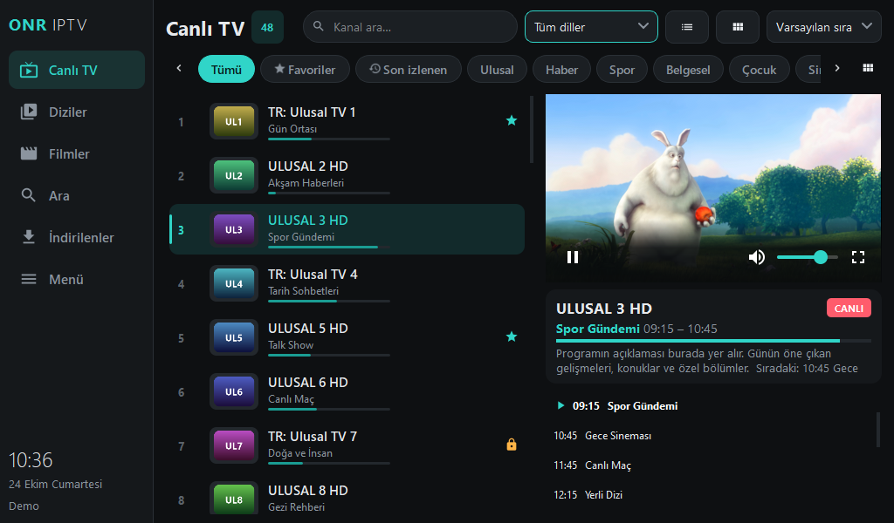

</div>

---

## English

ONR IPTV is a desktop IPTV player built with Python, Qt and libmpv. It runs on Windows and on a
Raspberry Pi 4 with a 7" 1024×600 touch screen from the same code base. The app ships with **no
built-in channels**: you add your own Xtream, M3U or Stalker account on first launch, and the list is
loaded from that account on every start.

### Screenshots

| | |
|---|---|
|  | 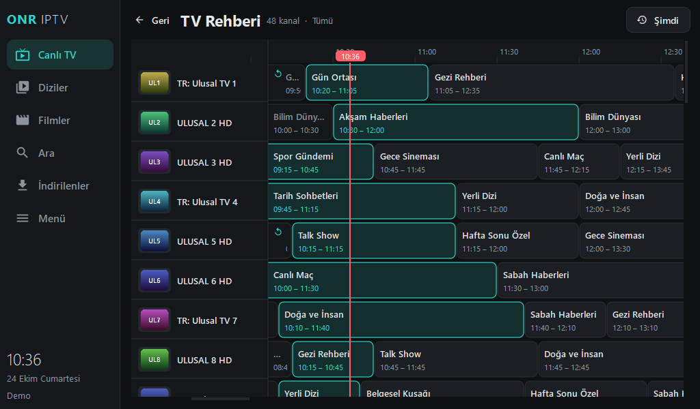 |
| **Live TV**: categories, language filter, EPG "now playing", preview player with its own controls, locked channels | **TV Guide**: all channels on a timeline, catch-up for archived programmes |
| 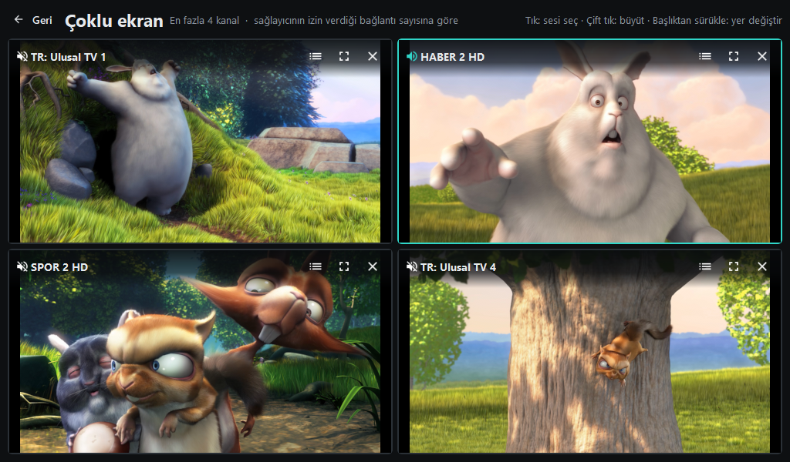 | 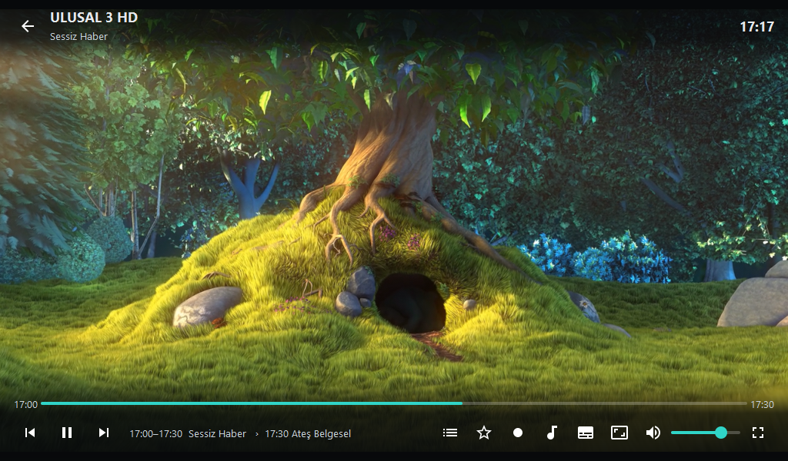 |
| **Multi-view (Windows)**: up to 4 channels, pick the audio, enlarge, drag to rearrange | **Player**: click / Space to pause, audio/subtitle/aspect, speed, Chromecast |
| 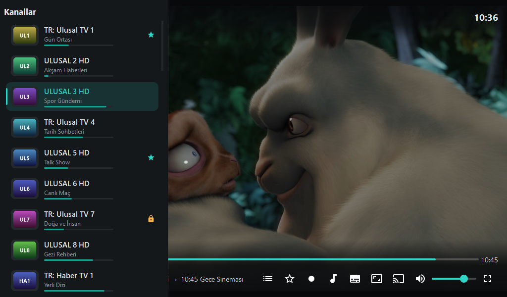 | 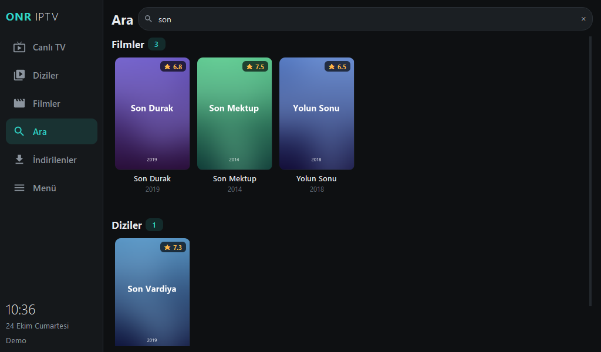 |
| **In-player channel list** for quick zapping | **Global search** across channels, movies and series |
| 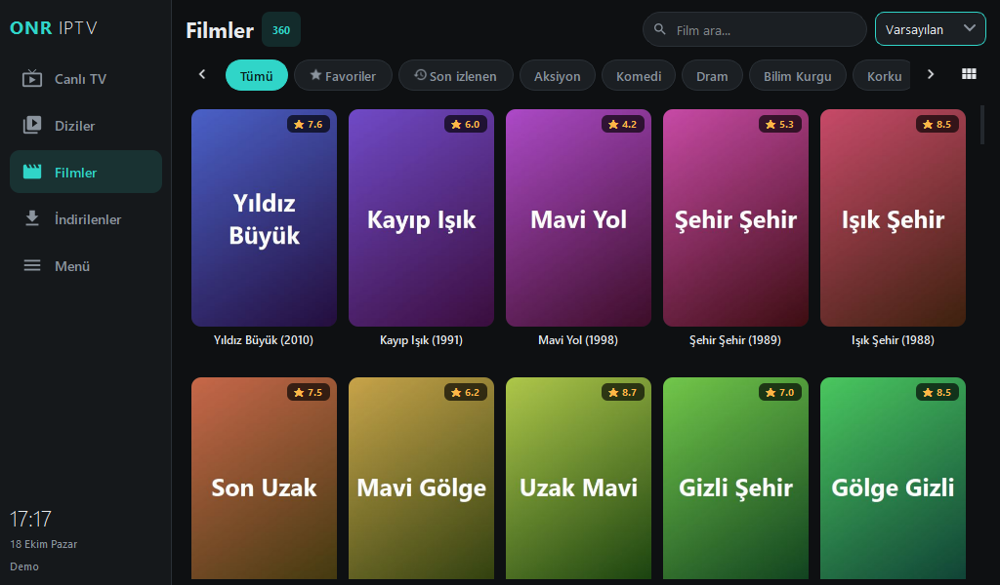 | 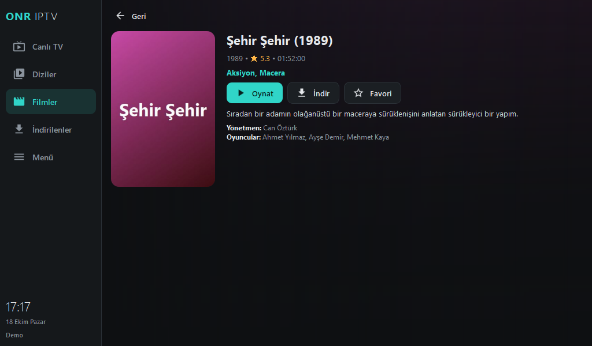 |
| **Movies**: poster grid, categories, language filter, watch progress | **Movie details**: plot, cast, resume, download, favourite |
| 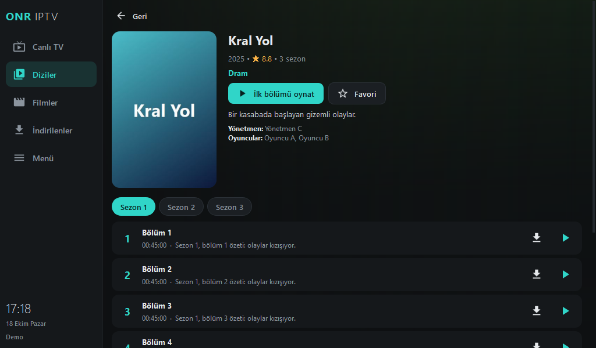 | 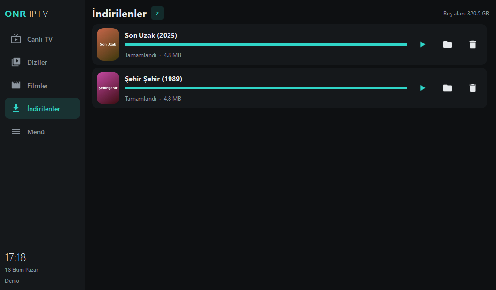 |
| **Series**: seasons, episodes, watched marks, live download status | **Downloads**: colour-coded states (downloading, downloaded, watching, watched), queue |
| 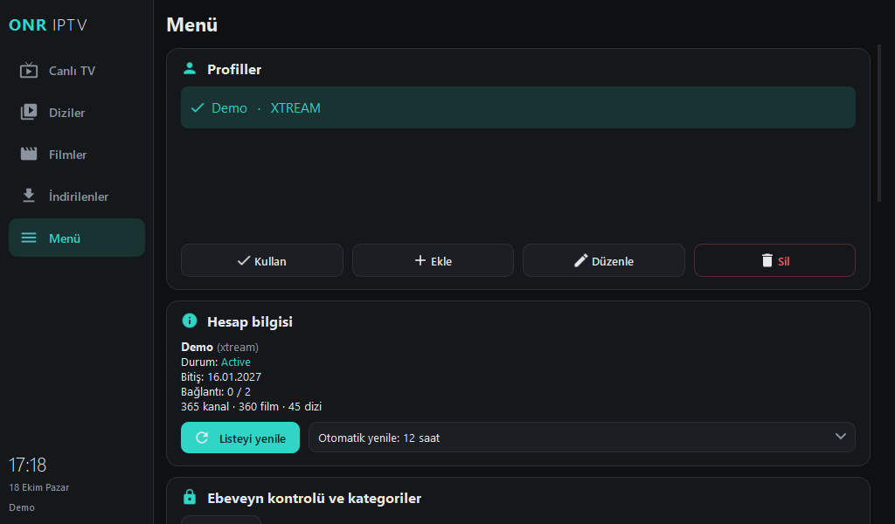 | 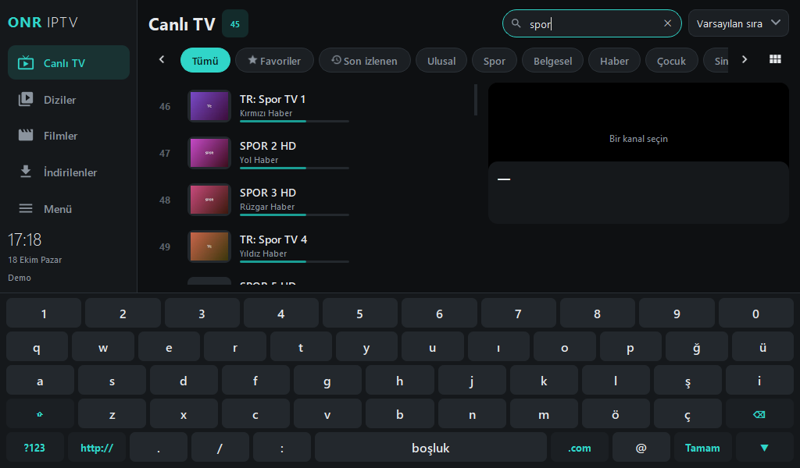 |
| **Menu**: profiles, account info, language, text size, player and parental settings | **On-screen keyboard** (Turkish Q layout); forms scroll so fields stay visible |

### Features

- **Live TV**: provider categories, favourites, recently watched (with remove / clear), search, sorting,
  preview player with its own play/pause and volume controls, "now playing" in the channel list,
  daily EPG, catch-up for archived programmes (Xtream).
- **TV Guide**: a full EPG grid of all channels on a timeline. Tap a programme on air to watch it, a past
  one to play the archive, or a future one for details.
- **Multi-view (Windows)**: watch up to 4 live channels at once, pick which one plays sound, enlarge one or
  drag to rearrange. The number of tiles follows the connection limit your provider reports.
- **Chromecast**: cast live channels, movies, series and downloaded files to a Chromecast / Google TV
  (via [pychromecast](https://github.com/home-assistant-libs/pychromecast)).
- **Global search** across channels, movies and series at once.
- **Content language filter**: languages are detected from tags such as `TR |`, `[DE]`, `UK:` in category
  and channel names.
- **Player**: libmpv with hardware decoding, overlay controls, channel up/down, audio track and subtitle
  selection, aspect ratio, playback speed, live recording, automatic reconnect, HLS quality limit.
- **Movies and series**: poster grid, detail pages, seasons and episodes, resume where you left off,
  automatic next episode, favourites from the player's star button.
- **Downloads**: movies and episodes with pause/resume (HTTP Range), a queue that respects your provider's
  connection limit (a second download waits instead of breaking the first), automatic retry from where it
  stopped when the connection drops, colour-coded states, live progress on the episode list, resume playback,
  watched / partly watched marks, files deleted from the folder disappear from the list.
- **Parental control**: lock single channels, movies, series or whole categories with a 4-digit PIN; after
  entering the PIN, protected content stays unlocked for 5 minutes.
- **Languages**: Turkish and English. The system language is used by default (Turkish if Windows is
  Turkish, otherwise English). Translations live in `app/lang/*.json`, so new languages can be added
  without code changes.
- **Multiple profiles**, adjustable text size, hiding categories, on-screen keyboard, compact sidebar.
- **Fast**: lists are cached on disk and open instantly, all network work runs in the background, and lists
  with tens of thousands of items scroll smoothly.

### Download (Windows)

Grab the latest `ONRIPTV-Windows.zip` from **[Releases](../../releases)**, extract it and run `ONRIPTV.exe`.
Keep the `_internal` folder next to the exe.

### Raspberry Pi 4

Raspberry Pi OS 64-bit (Bookworm or newer) is recommended.

```bash
git clone https://github.com/bilkeonur/ONR-IPTV.git ~/ONRIPTV
cd ~/ONRIPTV
./install_pi.sh
./run.sh
```

The script installs libmpv, Qt (system PyQt6 or PySide6) and the Python packages, and adds a menu entry.
It can also start the app at boot. On a 1024×600 screen the app opens full screen.

Pi-specific tuning that is already the default:

- Hardware decoding through the Pi's own decoders (`v4l2m2m` for H.264, `drm` for HEVC) with zero-copy
  dmabuf rendering. A 1080p H.264 live channel uses about 30% CPU.
- HLS quality limit of 2 Mbit/s. 1080p looks the same as 720p on a 600-line screen, and the limit avoids
  stalls on weak Wi-Fi.
- A workaround for a libmpv render API bug that leaks one GPU fence per frame. On Mesa v3d every fence is a
  file descriptor, so without the workaround video freezes after about 40 seconds.

### Run from source / build (Windows)

```bat
python -m pip install -r requirements.txt pyinstaller
run_windows.bat          :: run from source
build_windows.bat        :: builds dist\ONRIPTV\ONRIPTV.exe
```

`lib\libmpv-2.dll` is required and is not stored in the repository (GitHub's file size limit). Download
`mpv-dev-x86_64-*.7z` from [mpv-winbuild-cmake](https://github.com/shinchiro/mpv-winbuild-cmake/releases)
and put `libmpv-2.dll` into `lib\`.

### Keyboard shortcuts (player)

| Key | Action |
|---|---|
| Space / K | Play / pause |
| ← / → | Seek −10 / +10 s (movies, series) |
| ↑ / ↓ | Previous / next channel (live) |
| L or Enter | Channel list (live) |
| F / F11 | Full screen |
| M | Mute |
| + / − or mouse wheel | Volume |
| A / S | Audio track / subtitles |
| R | Start / stop recording (live) |
| Esc / Backspace | Back |

On a touch screen, tap the video to show or hide the controls. Long-press a list item for the context menu.

### Project structure

```
main.py                 entry point
app/config.py           paths, settings, per-profile user data
app/library.py          loading, disk cache, filtering, sorting
app/providers/          Xtream, M3U (+XMLTV) and Stalker clients behind a common interface
app/images.py           background image loader with disk and memory cache
app/epg.py              lazy "now / next" EPG service
app/downloads.py        download manager
app/cast.py             Chromecast discovery / casting and a small LAN file server
app/i18n.py             UI languages; translations in app/lang/<code>.json
app/ui/                 Qt user interface (pages, player, guide, search, multi-view, theme, icons)
tools/i18n_extract.py   collects translatable strings and reports missing translations
install_pi.sh           Raspberry Pi installer
ONRIPTV.spec            PyInstaller build definition
```

---

## Türkçe

ONR IPTV; Python, Qt ve libmpv ile yazılmış bir IPTV oynatıcıdır. Aynı kodla Windows'ta ve 7" 1024×600
dokunmatik ekranlı Raspberry Pi 4'te çalışır. Uygulamada **hiç hazır kanal yoktur**: ilk açılışta kendi
Xtream, M3U ya da Stalker hesabınızı eklersiniz, liste her açılışta bu hesaptan yüklenir.

### Ekran görüntüleri

| | |
|---|---|
|  |  |
| **Canlı TV**: kategoriler, dil filtresi, önizleme oynatıcı ve kontrolleri, kilitli kanallar | **TV Rehberi**: tüm kanallar saat çizelgesinde |
|  |  |
| **Çoklu ekran (Windows)**: 4 kanala kadar | **İndirilenler**: renkli durumlar ve kuyruk |

Diğer ekranlar için yukarıdaki [English](#screenshots) bölümüne bakın.

### Özellikler

| Bölüm | Neler var |
|---|---|
| **Canlı TV** | Servisten gelen kategoriler, Favoriler, Son izlenenler (tek tek silme / temizleme), arama, sıralama, kendi oynat/duraklat ve ses kontrolleri olan önizleme oynatıcı, listede "şu an yayında" bilgisi, günlük yayın akışı (EPG), arşivli kanallarda geçmiş yayını izleme (catch-up, Xtream) |
| **TV Rehberi** | Tüm kanalların saat çizelgesinde yayın akışı. Yayındaki programa dokununca kanal açılır, geçmiş programda arşiv oynar, ileri tarihlide ayrıntı gösterilir |
| **Çoklu ekran (Windows)** | Aynı anda 4 canlı kanala kadar; sesi verecek kanalı seçme, birini büyütme, sürükleyerek yer değiştirme. Kanal sayısı sağlayıcının izin verdiği bağlantı sayısına göre ayarlanır |
| **Chromecast** | Canlı yayın, film, dizi ve indirilen dosyaları Chromecast / Google TV'ye gönderme ([pychromecast](https://github.com/home-assistant-libs/pychromecast)) |
| **Genel arama** | Kanal, film ve dizilerde tek seferde arama |
| **İçerik dili filtresi** | Kategori ve kanal adlarındaki `TR \|`, `[DE]`, `UK:` gibi etiketlerden dil otomatik algılanır |
| **Oynatıcı** | Donanım hızlandırmalı libmpv, videoya tıklayınca ya da Boşluk ile oynat/duraklat, video üstü kontroller, kanal yukarı/aşağı, video üstünde kanal listesi, ses dili ve altyazı, görüntü oranı, hız, canlı yayın kaydı, otomatik yeniden bağlanma, yayın kalitesi sınırı, yıldız düğmesiyle favoriye ekleme |
| **Filmler / Diziler** | Poster ızgarası, detay ekranı, sezon ve bölüm listesi, kaldığın yerden devam, sonraki bölüme otomatik geçiş, favoriler |
| **İndirilenler** | Film ve bölüm indirme, duraklatıp kaldığı yerden devam, sağlayıcının bağlantı sınırına uyan indirme kuyruğu (ikinci indirme ilkini koparmaz, sırasını bekler), bağlantı koparsa kaldığı yerden otomatik yeniden deneme, renkli durumlar (indiriliyor / indirildi / izleniyor / izlendi), bölüm listesinde anlık ✓ işareti, indirilen içerikte kaldığı yerden oynatma, klasörden silinen dosyalar listeden kalkar, disk alanı kontrolü |
| **Ebeveyn denetimi** | Kanal, film, dizi ya da kategori bazında 4 haneli PIN ile kilit; PIN girilince korumalı içerik 5 dakika açık kalır |
| **Dil** | Türkçe ve İngilizce. Varsayılan sistem dilidir (Windows Türkçe ise Türkçe, değilse İngilizce). Çeviriler `app/lang/*.json` dosyalarındadır, kod değiştirmeden yeni dil eklenebilir |
| **Menü** | Birden fazla profil, hesap bilgisi (bitiş tarihi, bağlantı sayısı), yazı boyutu, donanım hızlandırma, tampon, TS/HLS, yayın kalitesi, kategori gizleme, ekran klavyesi, indirme klasörü |

Listeler diskte önbelleğe alınır, sonraki açılışlar anında yüklenir. Tüm ağ işlemleri arka planda
çalıştığı için arayüz donmaz.

### İndirme (Windows)

**[Releases](../../releases)** sayfasından `ONRIPTV-Windows.zip` dosyasını indirin, klasöre çıkarın ve
`ONRIPTV.exe`'yi çalıştırın. `_internal` klasörü exe'nin yanında kalmalıdır.

### Raspberry Pi 4 kurulumu

```bash
git clone https://github.com/bilkeonur/ONR-IPTV.git ~/ONRIPTV
cd ~/ONRIPTV
./install_pi.sh
./run.sh
```

Betik libmpv'yi, Qt'yi (sistemdeki PyQt6 ya da PySide6) ve Python paketlerini kurar, menüye kısayol ekler,
isterseniz açılışta otomatik başlatmayı ayarlar. 1024×600 ekranda uygulama tam ekran açılır, ekran klavyesi
Linux'ta varsayılan olarak açıktır.

Pi'de varsayılan olarak gelen ayarlar:

- Pi'nin kendi donanım çözücüleri (H.264 için `v4l2m2m`, HEVC için `drm`) kopyasız olarak kullanılır.
  1080p H.264 canlı yayın yaklaşık %30 CPU ile oynar.
- Yayın kalitesi en fazla 2 Mbit/s ile sınırlıdır. 600 satırlık ekranda 1080p ile 720p arasında fark
  görünmez, zayıf Wi-Fi'de takılma önlenir.
- libmpv render API'sindeki her karede bir GPU çiti sızdıran hata için düzeltme vardır. Bu düzeltme olmadan
  Pi'de görüntü yaklaşık 40 saniyede donar.

**Waveshare 7" HDMI ekran:** Görüntü doğru çözünürlükte gelmiyorsa `/boot/firmware/config.txt` dosyasına
şunları ekleyin:

```
hdmi_group=2
hdmi_mode=87
hdmi_cvt 1024 600 60 6 0 0 0
hdmi_drive=1
```

### Kaynaktan çalıştırma / derleme (Windows)

```bat
python -m pip install -r requirements.txt pyinstaller
run_windows.bat          :: kaynak koddan çalıştır
build_windows.bat        :: dist\ONRIPTV\ONRIPTV.exe üretir
```

`lib\libmpv-2.dll` gereklidir ve GitHub'ın dosya boyutu sınırı nedeniyle depoda yoktur.
[mpv-winbuild-cmake](https://github.com/shinchiro/mpv-winbuild-cmake/releases) sayfasından
`mpv-dev-x86_64-*.7z` indirip içindeki `libmpv-2.dll` dosyasını `lib\` klasörüne koyun.

### Klavye kısayolları (oynatıcı)

| Tuş | İşlev |
|---|---|
| Boşluk / K | Oynat / duraklat |
| ← / → | 10 sn geri / ileri (film, dizi) |
| ↑ / ↓ | Önceki / sonraki kanal (canlı) |
| L veya Enter | Kanal listesi (canlı) |
| F / F11 | Tam ekran |
| M | Sesi kapat |
| + / − veya fare tekerleği | Ses |
| A / S | Ses dili / altyazı |
| R | Kayıt başlat / durdur (canlı) |
| Esc / Backspace | Geri |

Dokunmatik ekranda videoya dokununca kontroller açılır ya da kapanır. Listelerde uzun basınca bağlam menüsü açılır.

### Veri konumları

| | Windows | Linux / Pi |
|---|---|---|
| Ayarlar ve profiller | `%APPDATA%\ONRIPTV` | `~/.config/onriptv` |
| Liste ve görsel önbelleği | `%LOCALAPPDATA%\ONRIPTV\cache` | `~/.cache/onriptv` |
| İndirilenler (varsayılan) | `Videolar\ONRIPTV` | `~/Videos/ONRIPTV` |

`ONRIPTV_HOME` ortam değişkeni verilirse tüm veriler o klasörde tutulur (taşınabilir kullanım).

### Notlar

- Birçok IPTV hesabı tek bağlantıya izin verir. İndirmeler bu sınıra göre sıraya alınır; indirme sürerken aynı
  anda izleme yapılamayabilir.
- HLS (`.m3u8`) olarak sunulan filmler doğrudan indirilemez, sadece izlenebilir.
- Chromecast yayını kendisi açar; sağlayıcıya özel User-Agent / Referer başlıkları gönderilemediği için bazı
  sağlayıcılarda TV'de açılmayabilir. İndirilen dosyalar yerel ağdan paylaşılır, ilk seferde Windows Güvenlik
  Duvarı izin isteyebilir.
- Yeni dil eklemek için `app/lang/tr.json` dosyasını kopyalayıp değerleri çevirin ve `app/lang/` ya da
  `%APPDATA%\ONRIPTV\lang` klasörüne koyun.
- Hesap bilgileri cihazda düz metin olarak saklanır.

---

## License / Lisans

ONR IPTV is free software under the **GNU General Public License v3.0 or later** ([LICENSE](LICENSE)).
Bundled components and their licenses are listed in [THIRD_PARTY_NOTICES.md](THIRD_PARTY_NOTICES.md).

ONR IPTV, **GNU Genel Kamu Lisansı v3.0 veya sonrası** ile dağıtılan özgür bir yazılımdır ([LICENSE](LICENSE)).
Birlikte dağıtılan bileşenler ve lisansları [THIRD_PARTY_NOTICES.md](THIRD_PARTY_NOTICES.md) dosyasındadır.

---

<div align="center">

Developed by / Geliştirici: **Onur BiLKE**

<sub>Screenshots use a local demo server. The video is <i>Big Buck Bunny</i> © Blender Foundation (CC BY 3.0).
Ekran görüntüleri yerel bir demo sunucuyla alınmıştır.</sub>

</div>
